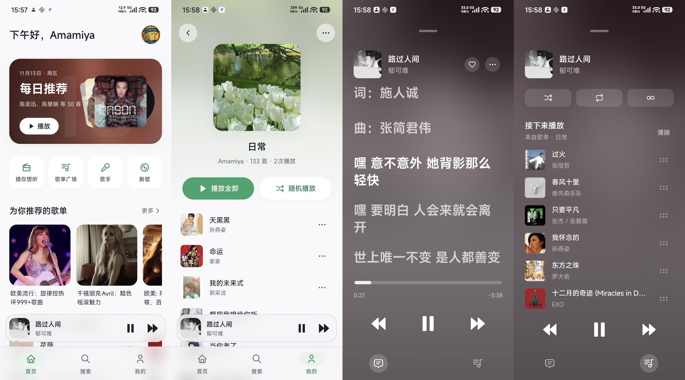

# Lilt for Android

使用 Kotlin 的 Lilt 安卓端，支持 Android 12（API 31）及以上版本。
> 为了更贴合移动端体验，所以和桌面版Lilt有很大出入。后续可能考虑统一跨平台开发方式。

## 已实现

- 首页每日推荐、个性化歌曲推荐
- 歌曲／歌手／专辑／歌单搜索
- 专辑页、歌手页（热门歌曲、歌曲与专辑数），多位歌手的歌曲先选择歌手；专辑与歌手页可层层返回。
- 提供已购音乐、收藏的专辑、收藏的歌单和自建歌单。
- 账号扫码登录、昵称头像、我的歌单、云端喜欢状态读取与切换。
- 登录凭据到期后自动续期
- 在线音源请求
- 音量均衡；淡入淡出
- 首页、歌单库、歌单／专辑／歌手详情和每日推荐先显示本地快照，按各自更新规则后台刷新；网络恢复后补充缺失或待更新的数据。
- 完整音频缓存及逐字歌词、翻译可离线使用；离线歌曲列表按实际缓存置灰，播放队列自动跳过不可播项。
- 新下载保留原歌曲 ID，在线歌曲列表和播放队列优先读取已下载音频，下载歌词可离线使用；下载文件不可用时回到常规缓存／网络播放。旧下载缺少原歌曲 ID，仍需从本地音乐列表播放，重新下载后可建立关联。
- 当前播放句独立逐字高亮；手动翻阅后停止自动跟随，点击歌词跳转或点击「回到当前」恢复跟随。

## 代码

- `data/`：QQ 音乐协议、数据解析、加密会话、网络状态和本地元数据／歌词快照。
- `playback/`：Media3 服务、完整音频缓存、播放控制与队列存档。
- `ui/`：Compose 页面、组件、底部面板和设计稿主题。
- `LiltViewModel.kt`：导航、页面状态和业务交互。

## 致谢

- [Lilt](https://github.com/Amamiya23/mygo-qyin)：QRC 解密、接口经验
- [qq-music-api](https://github.com/Rain120/qq-music-api)：通用网页版接口
- [Tabler](https://github.com/tabler/tabler-icons)：图标资源

**本项目与 QQ 音乐官方无关，音乐版权归各权利人所有。**

## 许可证

[AGPL-3.0](LICENSE)
